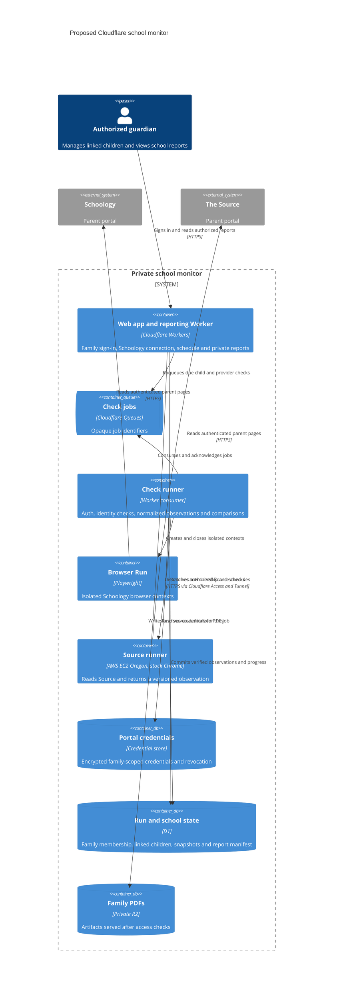

# Cloudflare migration plan

Build an invite-only web app that guardians can set up and use in a
phone or desktop browser. Each family gets its own sign-in, linked
children, and private reports. Scheduled checks run on hosted
infrastructure without a guardian device running.

The release requires both providers. Schoology supplies deadlines,
overdue items, and submission evidence. The Source supplies grades,
attendance, and official missing flags. Schoology works on Browser Run.
The Source rejected Browser Run and stock Chrome on Cloudflare Containers.
AWS EC2 in Oregon is the selected Source pilot runner after a successful
sign-in and a course-by-course coverage comparison with the Mac. See
[ADR 0006](adr/0006-source-access.md).

## Proposed C4 container view

Browser Run offers a Playwright integration. Validate the exact route
interception, redirect behavior, timezone, popup expansion and evaluation
methods the checker uses. Its host guardrails supplement the credential
request checks in `src/auth.js`. Schoology worked for one guardian account.
Validate the Worker binding and browser-based onboarding before expanding the
pilot.
[Playwright](https://developers.cloudflare.com/browser-run/playwright/) ·
[Browser guardrails](https://developers.cloudflare.com/browser-run/features/guardrails/) ·
[Browser limits](https://developers.cloudflare.com/browser-run/limits/).

## Model and isolation

- **Family and access:** use opaque family IDs and explicit memberships.
  Derive family access from the authenticated identity and server-side grants.
  Verify the grant again when serving a report or changing settings.
- **Provider account:** store a family-scoped guardian connection with a
  provider key, credential reference and connection state. Discover children
  from authorized parent views during onboarding.
- **Child mapping:** bind each local child ID to a stable identity discovered
  in each provider. Confirm the mapping during setup. Verify the active
  identity before reads and after navigation to a detail page. Ambiguous,
  changed or unavailable identities require reconfirmation.
- **Observations:** record family, child, provider, term, observed time,
  coverage and parser version. Prefer provider assignment IDs. Keep
  title/date matching as explicitly uncertain evidence when IDs are absent.
- **Report state:** track prior successful observations and per-section Friday
  baselines. Keep Source missing status, Schoology overdue and submission
  evidence separate. Use the actual local cutoff for deadlines. Verify a
  previously missing item on its assignment row before reporting clearance.

Carry family and child keys on the observations, changes, and report manifest.
Scope foreign keys and lookups to those keys so a valid child ID from another
family cannot be used on its own. Authorize each included child when a family
report combines several children. Reject caller-supplied provider selectors
outside the guardian's verified mappings.

Use separate browser contexts for each family and provider. Serialize child
switching within a shared guardian account if the portal stores selection
server-side. Test isolation even when contexts are distinct. Verify each
child on every check and prevent a partial or mismatched snapshot from
replacing another child's data.

Connect each portal from the web app with explicit guardian consent. Resolve
each credential through its family-scoped reference and authorize the family
before each use. Keep credential encryption keys separate from the database.
Use short-lived browser contexts and reauthenticate as needed. Verify how
login challenges are surfaced so a guardian can reconnect from a phone or computer.
Decide and test credential storage, revocation, and deletion before inviting
a second household. Validate portal rate limits and login flows during the
pilot.

## Scheduling and recovery

Cloudflare cron uses UTC. Trigger at both UTC hours that can map to 5 p.m.
Pacific and gate on the family timezone and local weekday. For a Seattle
pilot, the proposed trigger is `0 0,1 * * *`. Test Pacific DST boundaries
and the UTC date rollover, including Friday afternoon falling on Saturday
UTC. Use a bounded catch-up window and mark skipped or delayed runs.
[Cron Triggers](https://developers.cloudflare.com/workers/configuration/cron-triggers/).

Use a unique run key derived from family, child, provider and local schedule
slot. Queue messages carry the opaque job ID. The runner claims a renewable
lease, checks the lease version before commit, and acknowledges after the
state write. A failed or superseded attempt cannot overwrite a newer
snapshot. Commit verified observations and change records together. Record
the Friday baseline candidate with the report's input version. Queue retries
must be idempotent.
[Queue delivery guarantees](https://developers.cloudflare.com/queues/reference/delivery-guarantees/) ·
[D1 database API](https://developers.cloudflare.com/d1/worker-api/d1-database/).

Generate Friday reports from a recorded snapshot version with separate
coverage per provider and a visible verification time. Render a deterministic
HTML template in a separate browser context without portal credentials. Write
the PDF to an immutable R2 key, then mark the D1 manifest published and advance
the verified Friday baseline in the same database transaction. The manifest
controls visibility. A retry can publish the same version once. If rendering
or artifact storage fails, retry publication using the recorded inputs. Serve
PDFs through an authenticated Worker with a family and report check and
private cache policy.
[R2 public access controls](https://developers.cloudflare.com/r2/buckets/public-buckets/).

## Implementation sequence and exit criteria

| Phase | Work | Exit criteria |
| --- | --- | --- |
| 1. Extract local core (implemented) | Configure child mappings locally and add a shared provider observation contract. Normalize coverage and extract comparisons, cutoffs and report modeling into portable JS. Keep the local CLI and scheduled PDF workflow. | Existing fixtures pass. Two synthetic children with overlapping names and assignments stay separate. Unavailable results preserve verified state. |
| 2. Cloud compatibility | Keep the verified Schoology path. Test ordinary Chrome on a separate hosted Linux runner for Source. | Both providers accept hosted sign-in and match verified portal data. Schoology passed for one account on Browser Run. Source passed for one account on ordinary hosted Chrome. Cloudflare Containers failed the public Source probe. The Schoology Worker binding remains open. |
| 3. Web app pilot | Build family sign-in, both provider connection flows, a child picker, a responsive dashboard, and scheduled checks and reports. | A guardian can set up, reconnect, switch children, and review reports from phone and desktop browsers. Both providers update with no guardian device running. |
| 4. Invite more families | Add invite and membership controls, revocation and deletion, per-family workload limits, and a tested credential design. | Two synthetic families cannot read or overwrite each other’s records or sessions. Verify onboarding with a second consenting household before expanding. |

The [synthetic Browser Run check](../../scripts/browser-run/README.md)
passed all eight portal scenarios and the outbound request check on
November 10, 2026. The run took 54 seconds end to end. It used a local
Playwright controller with Cloudflare-hosted Chromium over CDP. The
Worker binding and scheduled operation still need verification. Schoology
passed both manual sign-in and a fresh automated login from Browser Run.
The automated login returned HTTP 302 and the read matched the Mac checker
across overdue work, upcoming work, events, and recently completed items.
The same public Source URL displayed the login form in Mac Chrome and a rejection page with a support ID in Browser
Run, before credentials were entered. Both responses used HTTP 200. The
cloud response lacked Cloudflare's guardrail marker. The evidence points
to filtering on the portal side, with the exact rule still unconfirmed.
Browser Run attaches identifying headers that cannot be removed and is
always classified as a bot, so no Browser Run setting changes this result.
See the [plan review](plan-review.md) and
[ADR 0006](adr/0006-source-access.md).

Before inviting families, verify the Cloudflare account limits and cost,
choose retention periods for reports and credentials, and test family
account deletion. The browser dashboard and private report links are the
planned delivery surfaces.

### Source on hosted Chrome

The [public sign-in probe](../../scripts/browser-run/README.md) reached
the actual Source login form (HTTP 200) with ordinary Chrome on a
GitHub Codespace in West US 2 and on a GitHub-hosted Linux runner. The
probe used no credentials.

On November 11, 2026, the
[one-time live check](../../scripts/browser-run/README.md) completed a
fresh automated sign-in and a verified read from a Codespace three
times. The compared run matched the Mac checker on roster and grades,
missing flags, and attendance. Both readers had two of nine courses
without a readable assignment table.

The Cloudflare Containers probe returned the portal rejection page at
12:32 p.m. Pacific. The AWS Oregon EC2 public probe reached the real login
form at 12:53 p.m. Pacific. A fresh automated login and verified read
completed at 1:16 p.m. A 1:34 p.m. follow-up matched the Mac's assignment
coverage on all nine rows. Seven classes had readable detail. School
Counselor HS and Program Support had no published grade link on either
runner. The AWS observation must keep those gaps unknown.

The [runner and Worker client](../../scripts/source-runner/README.md)
are implemented and tested together against a local fixture. The EC2
service, Cloudflare Tunnel and Access, and scheduled Worker deployment
remain to be verified live. See the [plan review](plan-review.md) for
the comparison limits.
