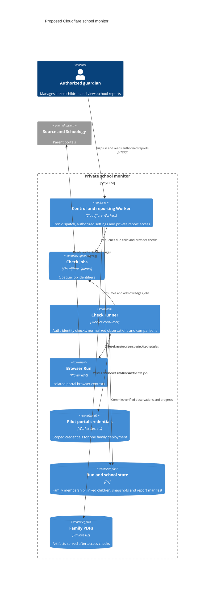

# Cloudflare migration plan

The first hosted release is a private pilot for one guardian account with
multiple linked children. The design includes a family boundary from the
start. A multi-family service requires a separate onboarding and credential
isolation decision before opening registration.

## Proposed C4 container view

Browser Run offers a Playwright integration. Validate the exact route
interception, redirect behavior, timezone, popup expansion and evaluation
methods the checker uses. Its host guardrails supplement the credential
request checks in `src/auth.js`. Portal acceptance of cloud-origin traffic
and account entitlements remain unverified.
[Playwright](https://developers.cloudflare.com/browser-run/playwright/) ·
[Browser guardrails](https://developers.cloudflare.com/browser-run/features/guardrails/) ·
[Browser limits](https://developers.cloudflare.com/browser-run/limits/).

## Model and isolation

- **Family and access:** use opaque family IDs and explicit memberships.
  Derive family access from the authenticated identity and server-side grants.
  Verify the grant again when serving a report or changing settings.
- **Provider account:** store a family-scoped guardian connection with a
  provider key, credential reference and connection state. Discover children
  from authorized parent views during onboarding.
- **Child mapping:** bind each local child ID to a stable identity discovered
  in each provider. Confirm the mapping during setup. Verify the active
  identity before reads and after navigation to a detail page. Ambiguous,
  changed or unavailable identities require reconfirmation.
- **Observations:** record family, child, provider, term, observed time,
  coverage and parser version. Prefer provider assignment IDs. Keep
  title/date matching as explicitly uncertain evidence when IDs are absent.
- **Report state:** track prior successful observations and per-section Friday
  baselines. Keep Source missing status, Schoology overdue and submission
  evidence separate. Use the actual local cutoff for deadlines. Verify a
  previously missing item on its assignment row before reporting clearance.

Carry family and child keys on the observations, changes, and report manifest.
Scope foreign keys and lookups to those keys so a valid child ID from another
family cannot be used on its own. Authorize each included child when a family
report combines several children. Reject caller-supplied provider selectors
outside the guardian's verified mappings.

Use separate browser contexts for each family and provider. Serialize child
switching within a shared guardian account if the portal stores selection
server-side. Test isolation even when contexts are distinct. Verify each
child on every check and prevent a partial or mismatched snapshot from
replacing another child's data.

For the private pilot, enter credentials directly as deployment-scoped
Worker Secrets. Use short-lived browser contexts and reauthenticate as
needed. Confirm portal rate limits and prompts before using real accounts
on a schedule. Multi-family onboarding needs a separate credential design,
such as a per-family deployment or an encrypted credential store with
independent key management and tenant checks. A secret reference in D1
identifies a credential without containing it.
[Worker Secrets](https://developers.cloudflare.com/workers/configuration/secrets/).

## Scheduling and recovery

Cloudflare cron uses UTC. Trigger at both UTC hours that can map to 5 p.m.
Pacific and gate on the family timezone and local weekday. For a Seattle
pilot, the proposed trigger is `0 0,1 * * *`. Test Pacific DST boundaries
and the UTC date rollover, including Friday afternoon falling on Saturday
UTC. Use a bounded catch-up window and mark skipped or delayed runs.
[Cron Triggers](https://developers.cloudflare.com/workers/configuration/cron-triggers/).

Use a unique run key derived from family, child, provider and local schedule
slot. Queue messages carry the opaque job ID. The runner claims a renewable
lease, checks the lease version before commit, and acknowledges after the
state write. A failed or superseded attempt cannot overwrite a newer
snapshot. Commit verified observations and change records together. Record
the Friday baseline candidate with the report's input version. Queue retries
must be idempotent.
[Queue delivery guarantees](https://developers.cloudflare.com/queues/reference/delivery-guarantees/) ·
[D1 database API](https://developers.cloudflare.com/d1/worker-api/d1-database/).

Generate Friday reports from a recorded snapshot version with separate
coverage per provider and a visible verification time. Render a deterministic
HTML template in a separate browser context without portal credentials. Write
the PDF to an immutable R2 key, then mark the D1 manifest published and advance
the verified Friday baseline in the same database transaction. The manifest
controls visibility. A retry can publish the same version once. If rendering
or artifact storage fails, retry publication using the recorded inputs. Serve
PDFs through an authenticated Worker with a family and report check and
private cache policy.
[R2 public access controls](https://developers.cloudflare.com/r2/buckets/public-buckets/).

## Implementation sequence and exit criteria

| Phase | Work | Exit criteria |
| --- | --- | --- |
| 1. Extract local core (implemented) | Configure child mappings locally and add a shared provider observation contract. Normalize coverage and extract comparisons, cutoffs and report modeling into portable JS. Keep the local CLI and scheduled PDF workflow. | Existing fixtures pass. Two synthetic children with overlapping names and assignments stay separate. Unavailable results preserve verified state. |
| 2. Cloud compatibility spike | Run synthetic portal fixtures on Browser Run. Verify HTTPS credential destinations, redirect behavior, popup reads, sanitized diagnostics and context cleanup. Then test one authorized guardian read with real credentials entered locally into the cloud secret interface. | Both portals read successfully from Cloudflare. Compare semantic outputs with a local run against the same term. Confirm no secrets or student data enter logs or recordings. Record runtime and cost. |
| 3. Private multi-child pilot | Add D1 mappings and durable run state. Add cron, bounded queue retries, private reports and authenticated access. Run alongside the local checker before switching. | Verify two linked children or an authorized live child plus synthetic coverage until a second is available. Exercise stale sessions, duplicate delivery, failed provider checks, DST, Friday cutoffs and rollback. Check same-family and cross-family authorization with synthetic tenants. |
| 4. Hosted cutover | Confirm where reports are read, retention and deletion terms, budget and access grants. Enable cloud reporting after checking parity. | Guardian can review progress and Friday reports with the Mac offline. Cloud errors surface clearly. Resume local reporting if cutover fails. |
| 5. Additional families | Decide credential isolation and onboarding. Add explicit consent, revocation, tenant deletion, operational support and workload limits. | An isolated tenant can onboard and delete its data. Cross-tenant authorization and browser state tests pass. |

The pilot needs an account entitlement and budget check, a real portal
compatibility result, a guardian access decision and a retention period
before deployment. The private report view is the proposed cloud delivery
surface. Delivering into the existing Codex chat is a separate integration
to validate. Account configuration, cloud secrets and deployments are
outside this documentation phase.
