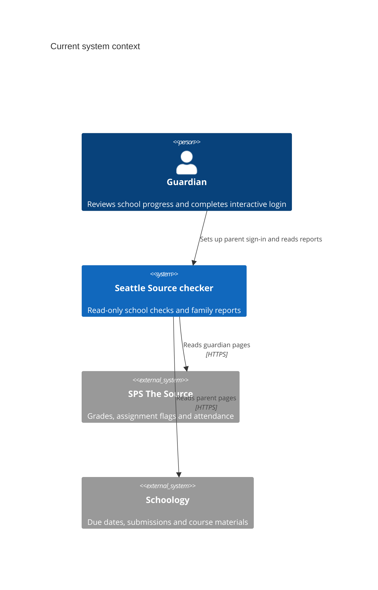
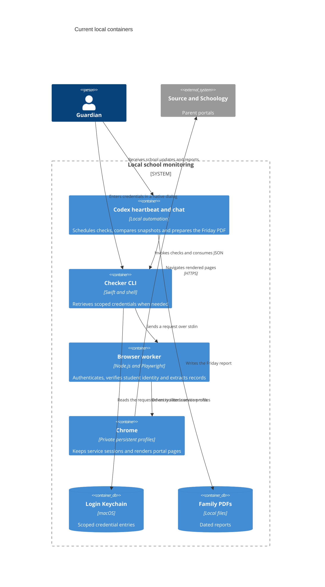
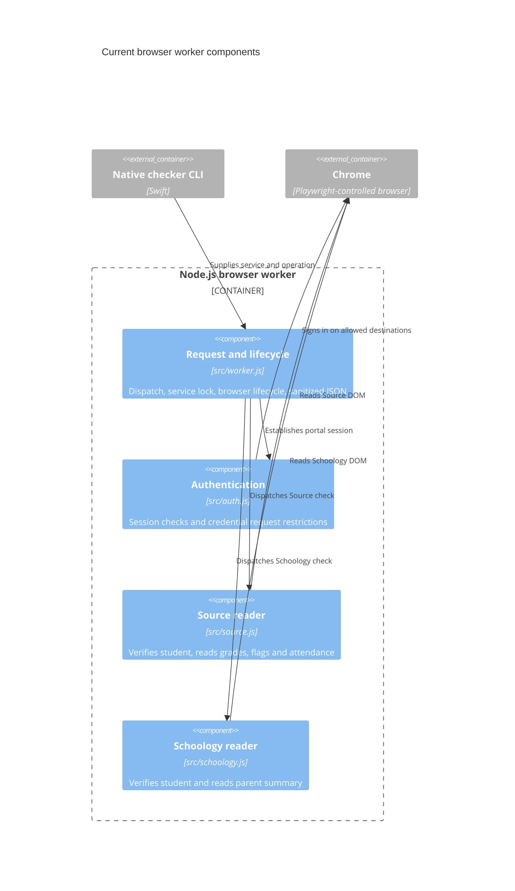

# Current architecture

The school checker is a local read-only workflow for one configured student per invocation.
The code baseline is commit `0312de9`, with the school-only operating scope
adopted on November 8, 2026. The schedule is weekdays at 5 p.m. Seattle time.
Friday runs also produce a family PDF.

## C4 level 1 — System context

## C4 level 2 — Containers on the Mac

The chat supplies comparison state, notification history, report wording,
and occasional verification in the guardian's regular Chrome session.
The repository provides the checker, tests and a portable JSON report model.
Friday PDF composition and the schedule live in the surrounding Codex workflow.
The checker preserves the original report and adds a versioned observation.

## C4 level 3 — Browser worker components

## Boundaries in the code

| Layer | Current implementation |
| --- | --- |
| Domain rules | Portal evidence is normalized in `src/core/observations.js`. The portable family model compares verified observations and classifies deadlines and submission evidence. |
| Use cases | Service checks in `src/worker.js`. The existing Friday baseline and PDF remain in Codex. |
| Adapters | Portal-specific readers in `src/source.js` and `src/schoology.js`. Both accept a Playwright page and use portal selectors. |
| Drivers | `bin/checker`, the Swift Keychain helper, Playwright and Chrome. |

The helper first tries the saved session. A `credentials_required` response
causes a second run with the requested credentials sent through a private
pipe. The worker uses a per-service file lock and closes Chrome on normal
exit. An abrupt process exit can leave a stale lock.

Source verifies the selected student in grade and detail headings. It
preserves unavailable assignment tables as unknown. Schoology requires
the student banner and reads visible overdue, upcoming and completed rows.
Detailed submissions can require a separate read in normal Chrome. Source
missing flags and Schoology overdue or submitted evidence retain their
separate meanings.

Sugarmate remains in the local source tree as a shelved integration.
The active schedule and default credential setup omit it. See
[ADR 0002](adr/0002-school-only-scope.md).
