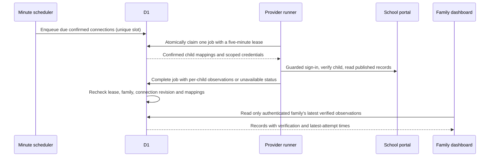

# Recurring hosted school checks

## Scope

After a parent confirms a child, the hosted app collects a first school snapshot.
It then collects Source and Schoology records on weekdays after 5 p.m. Seattle
time. The collector writes observations for the family dashboard. Optional
[hosted report email](hosted-report-email.md) sends these snapshots to per-child
recipient lists. It does not replace local reports or revive the shelved glucose feed.
Weekdays are not a verified school calendar. `HOSTED_CHECK_SKIP_DATES` is a JSON
array of ISO dates for explicit holidays or closures; the pilot defaults to no
exclusions. Do not advertise this as school-day-only polling without loading and
maintaining the relevant school calendar.

## Flow

The existing minute cron enqueues versioned, connection-scoped D1 jobs. The
schedule is evaluated in `America/Los_Angeles`, so daylight saving changes do not
move the local check time. Duplicate ticks cannot create duplicate daily jobs.
Each confirmed mapping set gets an initial check and a unique daily slot. Adding
another child permits an initial read of the new mapping set even if an earlier
check ran that day. Only confirmed mappings are collected; the selected dashboard
child does not restrict checks of other confirmed children.

The AWS Oregon service checks discovery first, then claims one Source collection
job when discovery is idle. The same systemd service serializes these activities.
The Cloudflare scheduled consumer similarly processes at most one Schoology job
per invocation. Jobs may wait behind other families; 5 p.m. is the start of the
check window rather than an exact delivery promise. An invocation can collect
one family's confirmed children in one fresh browser context and closes it after
use. No browser profile or cookies are persisted on either host.

## Failure and privacy controls

- Credentials remain encrypted on the versioned connection. Jobs store child
  mappings, never credential copies. Source permits only the verified child-selection form and the observed
  main-frame assignment lookup POST from its score page (bounded four-field JSON
  schema, exact origin/path and referrer). No internal API is reconstructed or
  replayed. Source uses its existing provider-scoped
  machine token over HTTPS; redirects are refused. Schoology stays inside the
  scheduled Worker. Request bodies and school records are not written to logs.
- A collection lease cannot be claimed unless its entire five-minute window remains before
  expiry. Browser collection has a four-minute deadline, leaving delivery time.
- Every result must contain exactly the claimed children, and its nested school
  entries must satisfy the observation schema. Adding or removing a confirmed
  child invalidates the older mapping-set result. Wrong-provider,
  forged-lease, duplicate-child, future-dated and incomplete results are rejected.
- Completion rechecks revocation, disconnect/reconnect revision, and every
  confirmed mapping inside the D1 write transaction. Reconnect waits for an older
  running browser to close or its lease to expire; its discovery deadline allows
  a fresh five-minute window after that lease. Stale results cannot restore
  access or write into another family's history.
- Sign-in or identity challenges pause that connection until an explicit parent
  reconnect. MFA, CAPTCHA and SSO are never bypassed. Ordinary collection failures
  are recorded as unavailable; no automatic same-day password retry occurs.
- Completed children are retained if a later child times out. Expired running jobs become unavailable attempts on a later poll. Failures
  append history and never overwrite verified records. Unknown assignment tables
  stay null, and submitted/overdue/missing remain separate evidence.

## Deployment and rollback

1. Apply migrations `0004_hosted_checks.sql` and `0005_check_attempts.sql` before deploying the Worker. Existing
   discovery now checks this table to avoid concurrent use of a parent account.
2. Deploy the Worker with `HOSTED_CHECKS_ENABLED=false` initially, preserving all
   existing secret bindings. Set `HOSTED_CHECK_SKIP_DATES` to a validated JSON array.
3. Update the AWS checkout to the reviewed commit, install the updated
   `source-discovery.service` (330-second timeout), and reload systemd. Its existing
   15-second timer and Parameter Store settings are reused. Never enable the legacy
   single-family scheduled service at the same time.
4. Enable `HOSTED_CHECKS_ENABLED=true`. The minute schedule creates initial jobs
   for existing ready connections and then daily slots. Verify both providers'
   actual `provider_checks` rows and dashboard times, with names and records kept
   private. Do not equate a successful onboarding job with a successful school read.
5. To stop new recurring checks, disable the flag. Disconnect/revoke when immediate
   invalidation of in-flight family work is required. Leave the additive migration
   in place; older onboarding code ignores the new table.

The local Keychain checker and existing family email/PDF automation are unchanged.
This does not invite another household. Live acceptance and second-household
onboarding remain separate checks before expanding the pilot.
